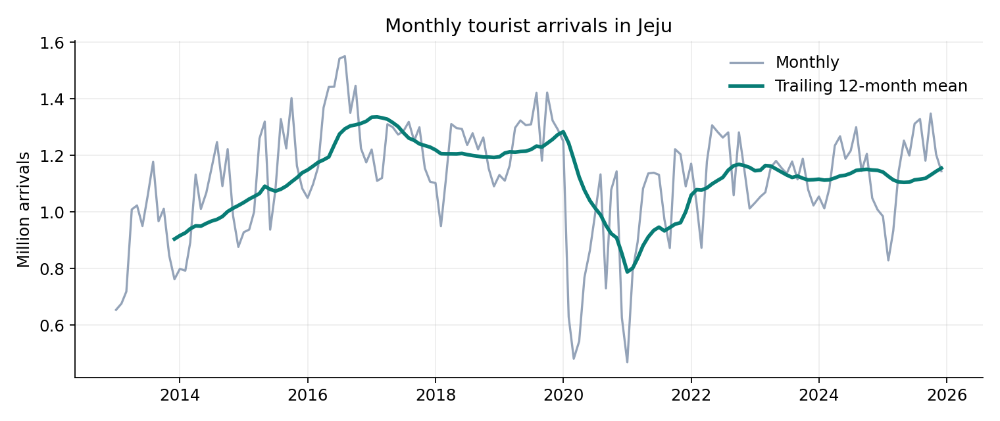
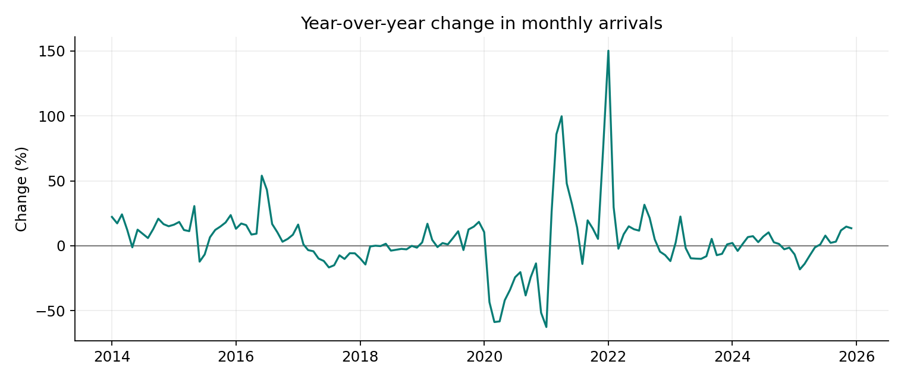
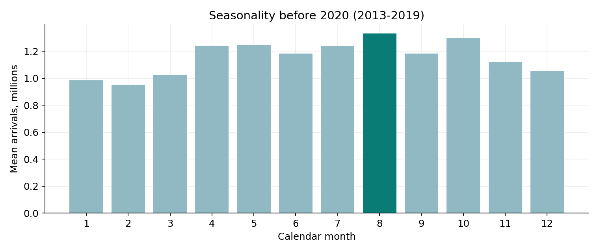
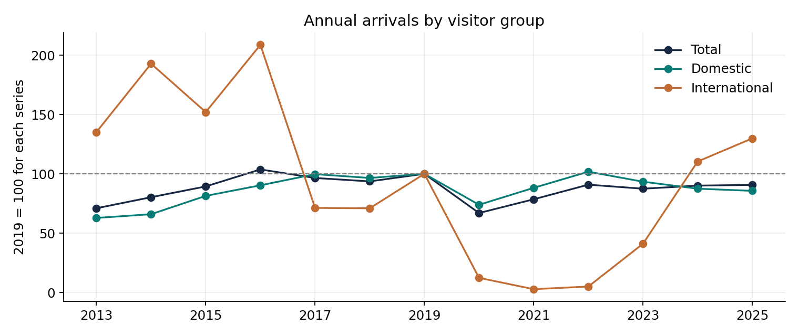
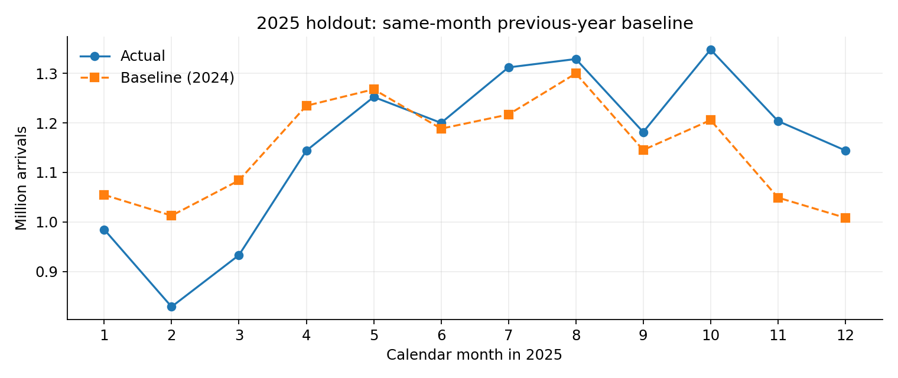
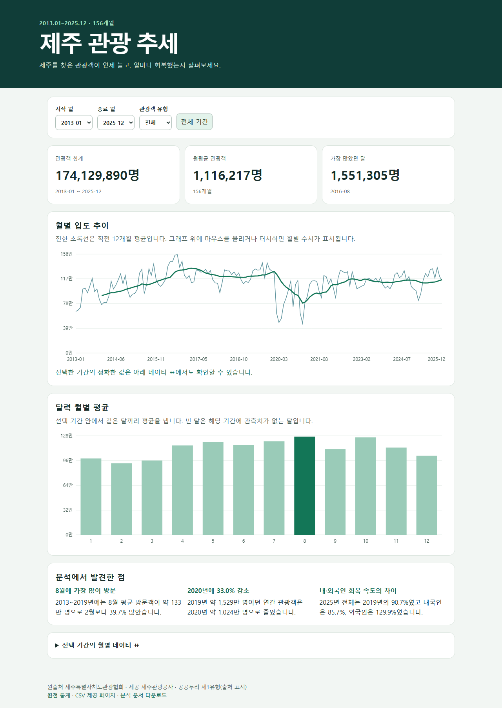
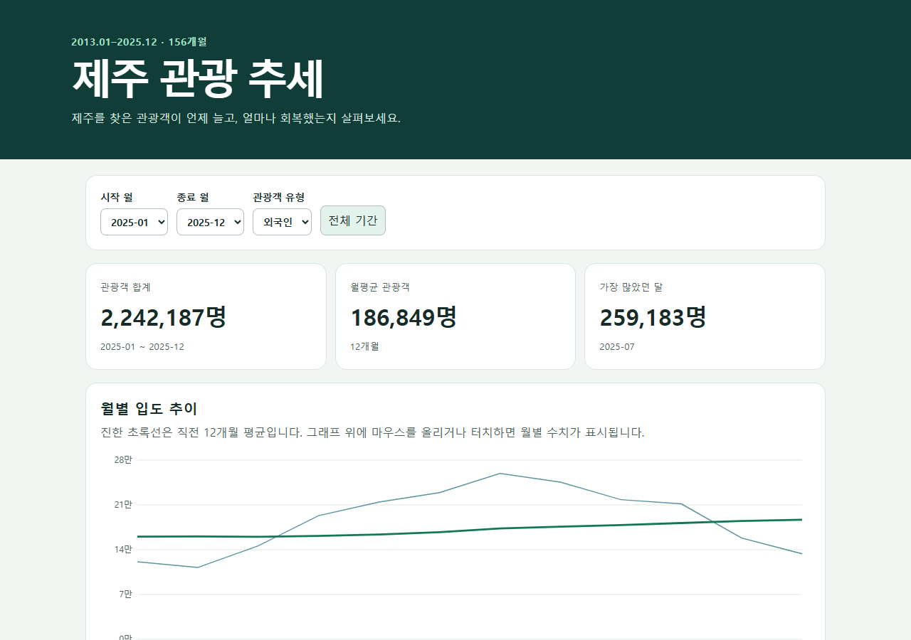

# 제주 관광객은 언제 늘고, 어디까지 회복했나

2013년 1월부터 2025년 12월까지 제주 월별 입도 관광객 **156개 관측치**를 분석했다.

## 분석 질문

1. 월별 변동을 완화하면 장기 추세는 언제 바뀌었나?
2. 2020년 이전에는 어느 달에 관광객이 많았나?
3. 2025년 전체와 내·외국인 관광객은 2019년 수준을 얼마나 회복했나?
4. 전년 같은 달의 실적으로 2025년을 예측하면 오차는 얼마나 큰가?

## 데이터와 정제

원출처는 제주특별자치도관광협회 입도통계다. 제주관광공사가 제공하는 항공·연안여객·크루즈 입도 집계를 제주 AI 관광데이터허브의 정규화 CSV로 내려받았다. 허브가 안내하는 이용조건은 **공공누리 제1유형(출처 표시)**이다. 재배포 시 원출처와 이용조건을 표시하고, 최신 조건은 제공 페이지에서 확인한다. [제주관광공사 원천 페이지](https://data.ijto.or.kr/prog/dataPick/bigdata/sub02/view.do?regSn=17) · [CSV 제공 페이지](https://data.wenivops.co.kr/d/ijto-17)

| 열 | 의미 |
|---|---|
| month | 기준연월(YYYY-MM) |
| total | 전체 입도 관광객(명) |
| domestic | 내국인 입도 관광객(명) |
| foreign | 외국인 입도 관광객(명) |

다운로드본 165행 중 연간 비교를 위해 2026년 1~9월 9행을 제외했다. 분석 구간을 월순으로 정렬하고 156개월의 연속성, 중복 월, 빈 값, 음수, 전체와 내·외국인 합계 일치 여부를 점검했다. 오류가 발견되면 스크립트를 중단하도록 했다. 분석 구간에서 오류가 발견되지 않아 보간이나 삭제는 없었다. 유난히 낮거나 높은 값도 집계 오류의 근거가 없고 합계 검증을 통과하면 보존했다.

## 1. 급감과 부분 회복



**관찰.** 연간 관광객은 2019년 15,286,136명에서 2020년 10,236,445명으로 약 33.0% 줄었다. 2022년에는 13,889,502명까지 늘었고 2023년에 다시 줄었다. 12개월 이동평균은 해당 월과 직전 11개월의 평균으로, 한 해의 달력 월을 모두 포함해 월별 계절 변동을 완화한다. 첫 11개월에는 평균을 표시하지 않는다.

**해석.** 2020년 급감은 코로나19 시기 여행 수요와 이동 여건이 달라졌다는 가설과 부합한다. 이후 회복 속도는 해마다 달랐으며, 이동평균은 급격한 전환을 실제보다 늦게 보여줄 수 있다.



**관찰.** 전년 동월 대비 변화율은 (당월 ÷ 전년 같은 달 − 1) × 100으로 계산했다. 2021년 1월은 468,016명으로 분석 기간 최저이자 전년 동월 대비 −62.6%였다. 이 낮은 값을 분모로 사용하는 2022년 1월 변화율은 +150.2%였다.

**해석.** 낮은 비교 기준이 반등률을 크게 보이게 한다. 회복 수준을 판단할 때는 변화율과 방문객 절대 규모를 함께 봐야 한다.

## 2. 코로나19 이전에는 8월 방문객이 가장 많았다



**관찰.** 2013~2019년의 같은 달 7개 관측치를 평균하면 8월이 1,331,983명으로 가장 많았고 2월이 953,535명으로 가장 적었다. 8월 평균은 2월보다 약 39.7% 높았다. 10월도 평균 1,295,585명으로 높았다.

**해석.** 여름 휴가와 가을 여행 수요가 월별 차이에 기여했을 가능성이 있다. 2월은 일수가 짧아 월 합계가 낮아질 수 있다. 월별 운영 계획에 활용한다면 일평균 입도객과 연휴 날짜도 함께 비교할 필요가 있다.

## 3. 내국인과 외국인의 회복 경로가 달랐다



**관찰.** 각 집단의 2019년 연간 합계를 100으로 두면 2025년 전체는 90.7, 내국인은 85.7, 외국인은 129.9였다. 2019년보다 외국인은 516,055명 증가했고 내국인은 1,940,453명 줄어 전체는 1,424,398명 감소했다.

**해석.** 외국인 증가분이 내국인 감소분을 일부 상쇄했다. 전체 회복률만 보면 두 집단의 서로 다른 흐름을 놓칠 수 있어, 방문객 구성이 중요한 사업에서는 각각의 지표를 추적할 이유가 있다.

## 4. 보너스 · 2025년 계절 기준선 예측



2024년의 각 달 실적을 2025년 같은 달의 예측값으로 사용했다. 예측값을 만드는 데 2025년 관측치는 사용하지 않았고 평가에만 썼다.

**관찰.** 12개월 평균 절대오차(MAE)는 93,062명, 평균 절대백분율오차(MAPE)는 8.62%였다. 가장 큰 절대오차는 2월의 184,059명이었다.

**해석.** 계절 패턴과 수요 규모가 전년도와 비슷하다는 가정은 간단한 비교 기준을 제공한다. 연휴 시점, 여행 수요, 교통 공급이 바뀌면 오차가 커질 수 있다. 단 한 해 평가이므로 다른 해에도 같은 정확도가 유지된다고 판단하기 어렵다.

## 결론과 한계

코로나19 이전에는 8월과 10월의 월평균 방문 규모가 컸다. 2025년 외국인 방문은 2019년 수준을 넘었고, 내국인 방문은 2019년 수준보다 낮았다. 성수기 인력이나 수송 계획을 세울 때는 달력 월과 방문객 구성을 함께 살피는 편이 이 자료에 부합한다.

추세는 여러 달에 걸친 수준 변화, 계절성은 특정 달에 반복되는 패턴이다. 두 패턴으로 설명되지 않는 단기 변동에는 일시적인 사건과 측정 변동이 섞일 수 있다. 여기서는 월별 집계만 분석했으므로 기상·연휴·항공편의 개별 효과, 체류기간, 관광 소비를 확인할 수 없다. 계절성 비교도 2013~2019년으로 제한되어 최근 수요에 그대로 적용하기 어렵다.

## AI 사용 로그

| 사용 작업 | 사용 이유 | 검증 방법 |
|---|---|---|
| 출처 탐색과 전처리 코드 작성 | 월별 확정치를 찾고 검증을 반복 실행하기 위해 | 제공 페이지의 열 정의를 확인하고 CSV 156개월 연속성 및 내·외국인 합계를 코드로 검사했다. |
| 시각화와 계절 기준선 구현 | 장기 추세, 월별 패턴, 예측 오차를 비교하기 위해 | 스크립트를 실행해 이미지 5개를 생성했고 평가에 2025년 실적만, 예측값에는 2024년 실적만 쓰이는지 인덱스를 확인했다. |
| 인사이트와 문장 초안 작성 | 가능한 설명을 탐색하고 관찰과 가설을 나누기 위해 | 스크립트가 출력한 집계와 리포트 수치를 대조하고, 원인으로 제시한 설명은 가설로 표시했다. |

## 실행

Python 3.10 이상에서 저장소 루트에 들어간 뒤 실행한다.

```powershell
python -m pip install -r requirements.txt
python analyze.py
```

분석 스크립트가 figures 폴더에 PNG 5개를 저장하고 주요 수치를 터미널에 출력한다.

## 데이터

data/jeju_monthly.csv는 2026-11-16에 수집한 CSV 스냅샷이다. 그대로 실행하면 같은 기간을 분석한다. 데이터를 다시 수집하려면 아래 링크에서 CSV를 내려받아 해당 경로에 저장한다. 제공처가 과거 값을 수정하면 결과도 달라질 수 있다. 원출처는 제주특별자치도관광협회이며, 제공처는 제주관광공사다. 허브에 표시된 데이터 이용조건은 공공누리 제1유형(출처 표시)이다. [제주관광공사 원천 페이지](https://data.ijto.or.kr/prog/dataPick/bigdata/sub02/view.do?regSn=17) · [CSV 다운로드](https://data.wenivops.co.kr/data/ijto-17.csv)

## 웹 대시보드

저장소 루트에서 로컬 서버를 실행하고 브라우저에서 [대시보드 열기](http://localhost:8000)를 선택한다.

```powershell
python -m http.server 8000 --bind 127.0.0.1
```

시작 월과 종료 월을 2019년 1월~2020년 12월로 지정하고 관광객 유형을 내국인 또는 외국인으로 바꾸면 선택 구간의 합계, 월평균, 최고 방문 월과 두 그래프가 갱신된다. 아래의 데이터 표에서 월별 수치도 확인할 수 있다.

### 대시보드 화면

**전체 기간 · 전체 관광객**
2013년 1월~2025년 12월의 월별 추이와 달력 월별 평균을 볼 수 있다.



**필터 예시 · 2025년 외국인 관광객**
시작 월을 2025년 1월로 바꾸고 관광객 유형에서 외국인을 선택하면, 선택한 12개월의 합계가 2,242,187명으로 갱신된다.



### Vercel 배포

이 GitHub 저장소를 Vercel에서 가져오고 프로젝트 루트에서 Deploy를 누른다. 정적 사이트 설정은 vercel.json에 포함되어 있다. Vercel CLI를 사용하는 경우 저장소 루트에서 로그인한 뒤 배포한다. [Vercel 배포 안내](https://vercel.com/docs/deployments)

```powershell
npx vercel login
npx vercel deploy --prod
```
